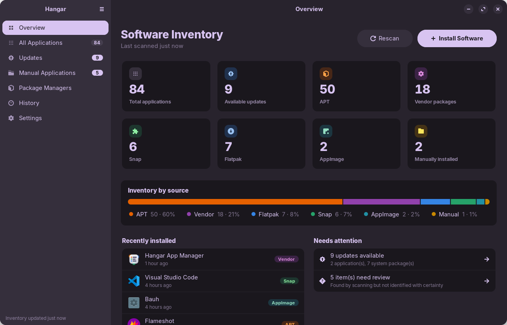
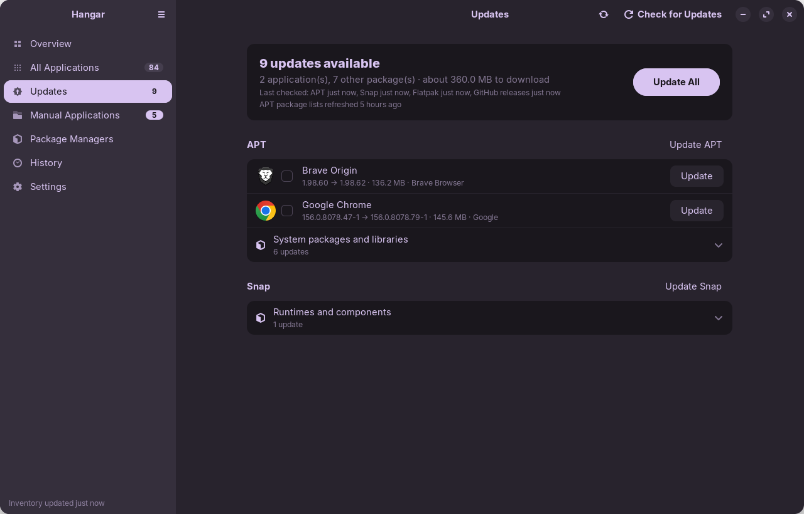
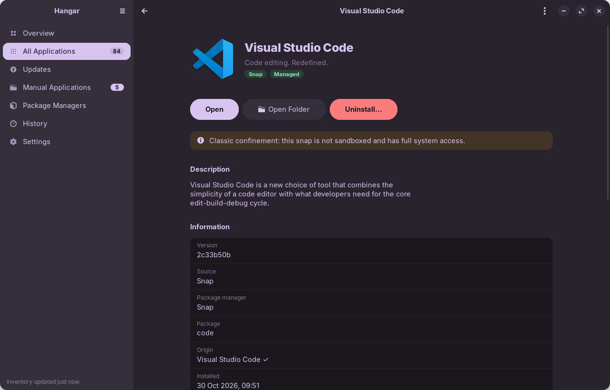
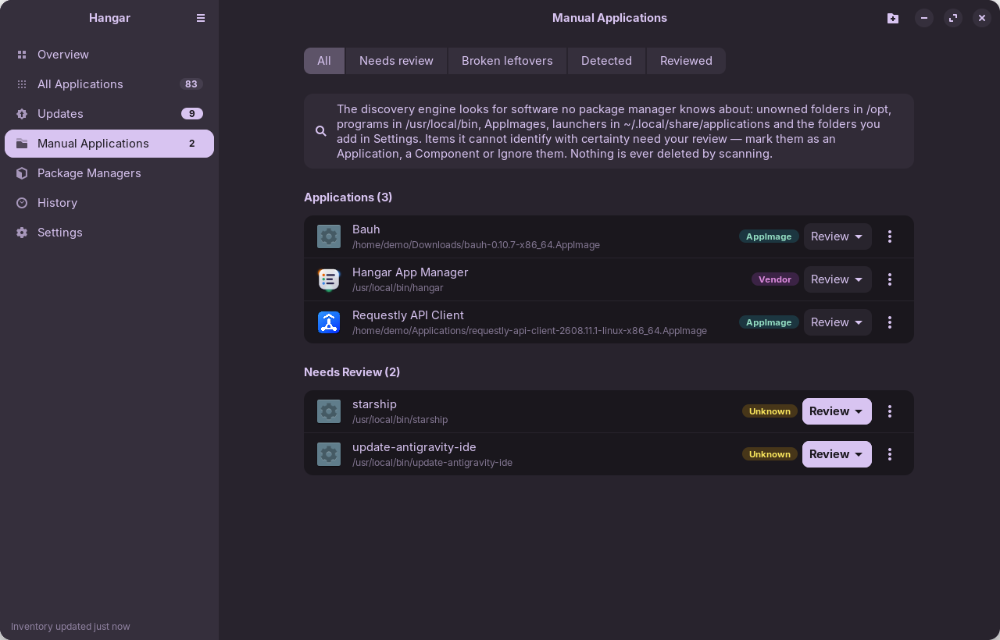
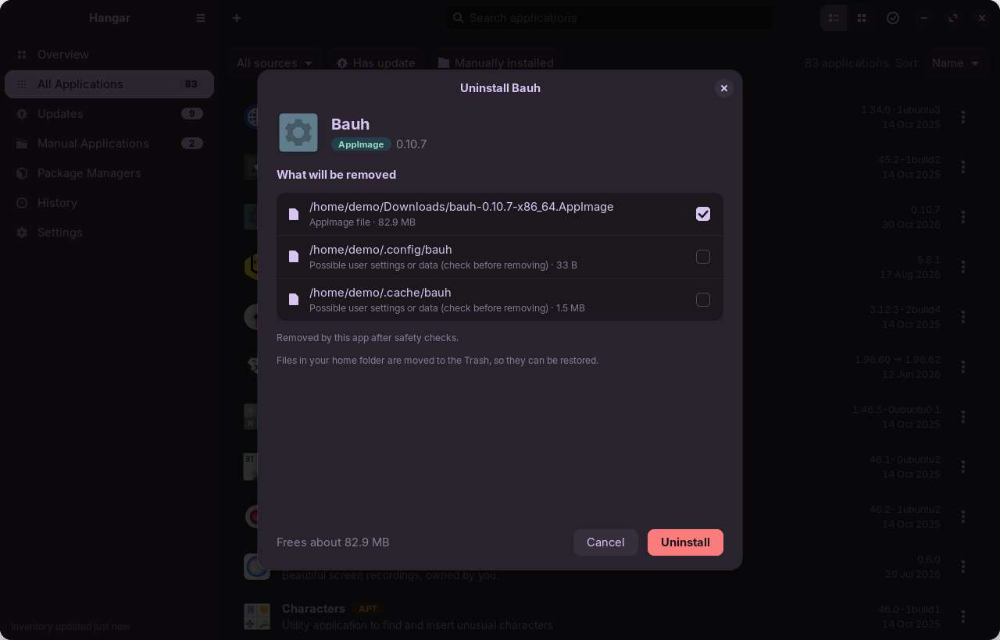
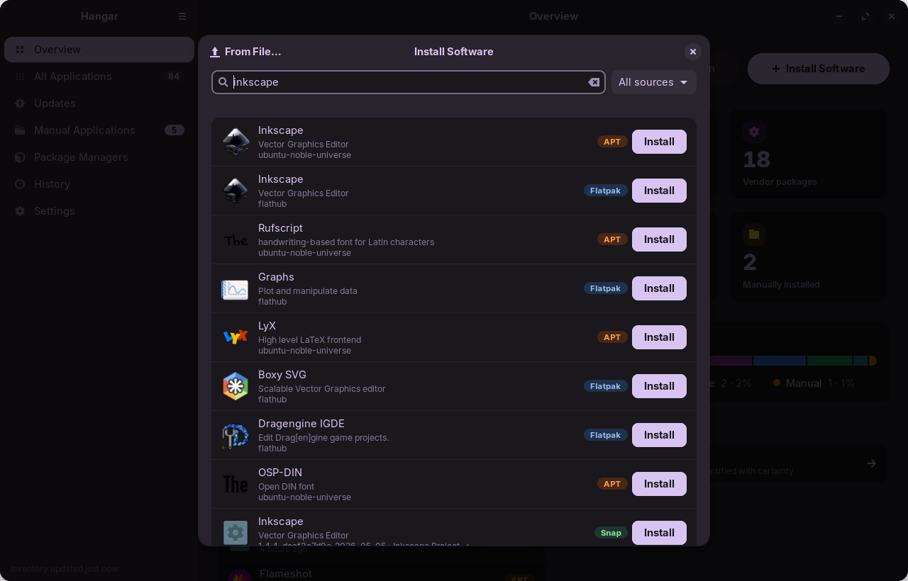
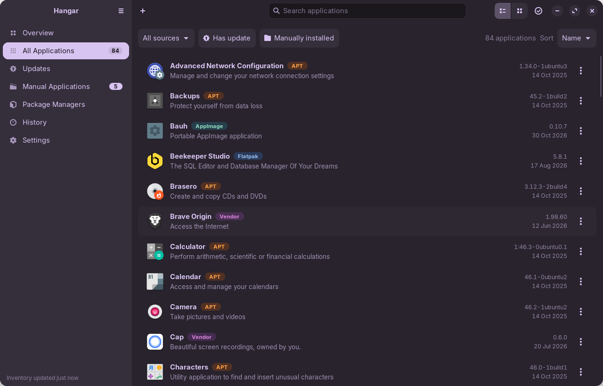

<div align="center">


# Hangar - Unified App Manager for Linux

**One inventory for every application on Ubuntu, whatever installed it.**

<p>
  <a href="#requirements"></a>
  <a href="#requirements"></a>
  <a href="#requirements"></a>
  <a href="#requirements"></a>
  <a href="LICENSE"></a>
</p>

<p>
  <a href="#features"></a>
  <a href="#features"></a>
  <a href="#features"></a>
  <a href="#features"></a>
  <a href="#features"></a>
  <a href="#features"></a>
</p>



</div>

## Why Hangar

A typical Ubuntu machine gets software from half a dozen places: the Ubuntu archive, PPAs and vendor
repositories, `.deb` files downloaded from a website, Snaps, Flatpaks, AppImages in `~/Downloads`, and
whatever someone unpacked into `/opt`. Each source has its own tool, and none of them shows the whole
picture. Uninstalled apps leave broken launchers behind, and nothing tells you when the AppImage you
downloaded six months ago has a new release.

Hangar reads every one of those sources and puts the results in a single list. For each app it shows
where it came from, which version you have, whether an update is available and what removing it would
actually touch. Scanning runs as your user, needs no root and never executes the software it finds.

## Features

- **One list for everything.** Icon, name, source, package, version, install date, location, size and
  update state for every app. When the same app is installed through two sources (say a Snap and a
  Flatpak), Hangar groups them, and you can still manage each installation separately.
- **Finds what package managers don't know about.** Unowned folders in `/opt`, programs in
  `/usr/local/bin`, AppImages, web apps and launchers in `~/.local/share/applications`, plus any folders
  you add. Anything Hangar can't identify with confidence goes to a review queue, where you mark it
  *Application*, *Component* or *Ignore*. Your decisions are remembered across scans.
- **Leftover detection.** Lists broken launchers and dangling symlinks left behind by removed software so
  you can clean them up.
- **Updates from every source.** APT (with phased-update awareness), Snap and Flatpak. Update a single
  app, a selection, one source, or everything at once, with live progress.
- **GitHub release tracking.** Get alerts for AppImages, downloaded `.deb` files and manual installs that
  come from GitHub. Hangar finds the repository in AppImage update information or package homepages, or
  you link it yourself with built-in search. Downloads are checksum-verified when GitHub publishes a
  digest. AppImages are replaced in place: launchers are repointed and the old version goes to the Trash.
- **Install software.** Search the APT and Flatpak catalogues (AppStream) and the Snap Store, or open a
  `.deb`, `.flatpakref` or AppImage file. APT installs show a dry run of the dependencies first.
- **Uninstall without surprises.** Each source is removed with its own tool (`apt-get`, `snap`,
  `flatpak`). AppImages and manual installs are removed file by file. Every removal shows a preview
  first, and files in your home folder go to the Trash.
- **History.** Records installs, removals, updates, failures, discoveries and review decisions with
  timestamps. It never stores command output or credentials.
- **Native GNOME app.** GTK 4 and libadwaita, light and dark themes, adaptive layout, keyboard shortcuts.

## Screenshots

| | |
| :---: | :---: |
|  |  |
| **Updates** from APT, Snap, Flatpak and GitHub in one place | **App details** with source, origin and safety notes |
|  |  |
| **Manual applications** and the review queue | **Uninstall preview**: every path, user data unchecked by default |
|  |  |
| **Install software** from APT, Flatpak and the Snap Store | **All applications** with filters by source and update state |

## Requirements

- Ubuntu 24.04 LTS or a derivative (developed and tested on Zorin OS 18, which is based on 24.04)
- Python 3.12, GTK 4.14 and libadwaita 1.5, the versions that ship with 24.04
- `pkexec` (PolicyKit) for administrative actions

Optional:

| Package | Enables |
| --- | --- |
| `python3-apt` | repository origins and APT update details |
| `gir1.2-appstream-1.0` | catalogue search in *Install Software* |
| `snapd` | Snap integration (preinstalled on Ubuntu) |
| `flatpak` | Flatpak integration |

`./scripts/install-deps.sh` installs everything you need.

## Installation

### Option 1: download the .deb (recommended)

Download `hangar_<version>_all.deb` from the
[latest release](https://github.com/Rajveer-Mahida/hangar/releases/latest), then install it with apt,
which also pulls in the dependencies:

```bash
cd ~/Downloads
sudo apt install ./hangar_*_all.deb
```

Remove it with `sudo apt remove hangar`.

### Option 2: build from source

```bash
git clone https://github.com/Rajveer-Mahida/hangar.git
cd hangar
./scripts/install-deps.sh          # installs the apt dependencies (asks for sudo)

./scripts/build-deb.sh             # builds dist/hangar_<version>_all.deb, no root needed
sudo apt install ./dist/hangar_*_all.deb
```

To skip the package and install straight into `/usr/local` instead:

```bash
sudo ./scripts/install.sh          # or: sudo ./scripts/install.sh /usr
sudo ./scripts/uninstall.sh        # removes it again
```

Every option installs the app, a root-owned privileged helper and one PolicyKit action per helper
command. Open **Hangar App Manager** from the app grid or run `hangar`. Uninstalling keeps your
inventory database.

### Option 3: run from source

```bash
./run.sh                           # after the clone and install-deps.sh steps above
```

This runs the app straight from the source tree in *development mode*. Administrative actions go through
`pkexec` with the helper from the source folder, and PolicyKit asks for your password every time. Without
`run.sh` and without an installed helper, install, update and remove actions are disabled instead of
falling back to something less safe. For everyday use, install the app with option 1 or 2.

> [!TIP]
> If the app grid still shows an old name or icon after installing, GNOME Shell is using a cached
> copy. On X11 press <kbd>Alt</kbd>+<kbd>F2</kbd>, type `r` and press <kbd>Enter</kbd>, or log out
> and back in.

## Usage

The first launch scans your system, which takes a few seconds and doesn't need your password. After
that:

- **Overview** shows counts per source, available updates and anything that needs attention.
- **All Applications** is the full inventory. Search, filter by source or update state, sort, or switch
  to grid view. Select several apps to uninstall them together.
- **Updates** groups updates by source. Apps are listed first, and libraries and runtimes are folded
  away.
- **Manual Applications** is where discovered software and the review queue live.
- **Package Managers** shows which integrations are available, plus GitHub tracking status.
- **History** and **Settings** do what they say.

**Opening files.** `hangar ~/Downloads/some-app.deb` (or *Open With → Hangar App Manager* in the file
manager) opens the install preview for `.deb`, `.flatpakref` and AppImage files.

**GitHub rate limit.** Anonymous GitHub API access allows 60 requests per hour. Results are cached
with ETags, which is enough for most machines. For more, start Hangar with `GITHUB_TOKEN` set in its
environment. A fine-grained token with read-only access to public repositories is all it needs. The
token is never written to disk.

### Keyboard shortcuts

| Shortcut | Action |
| --- | --- |
| <kbd>Ctrl</kbd>+<kbd>F</kbd> | Search applications |
| <kbd>Ctrl</kbd>+<kbd>I</kbd> | Install software |
| <kbd>Ctrl</kbd>+<kbd>R</kbd> / <kbd>F5</kbd> | Rescan |
| <kbd>Ctrl</kbd>+<kbd>,</kbd> | Settings |
| <kbd>Ctrl</kbd>+<kbd>Q</kbd> | Quit |

## Safety model

Hangar manages system software, so it follows strict rules:

- **No shell, ever.** Every command is an argument list (`Gio.Subprocess` / `subprocess`). There is no
  `shell=True`, no `sh -c` and no `sudo` built from strings.
- **Root only when needed.** Scanning, update checks, dry runs and Trash operations run as you. Changes
  to the system go through `pkexec` and a small, self-contained helper. The helper never imports code
  from user-writable locations, and each of its commands has its own PolicyKit action. Installs and
  removals ask for your password every time. Only updates and package-list refreshes keep the
  authorization for a few minutes.
- **Validated twice.** Package names, snap names, Flatpak refs and remotes, and paths are checked in the
  app and checked again by the root helper. APT action suffixes such as `foo-` or `foo+` are rejected.
- **The preview is a contract.** APT removals are simulated first. The exact sets of packages to be
  removed *and* installed are passed to the helper, which simulates again and aborts if either set has
  changed. Removing core desktop packages triggers a prominent warning. Dependencies that become unused
  are listed but never removed automatically.
- **Installs never remove.** Installs and upgrades run with `apt-get --no-remove`.
- **What you reviewed is what gets installed.** For `.deb` and `.flatpakref` files the SHA-256 is pinned
  when the preview is shown. The helper copies the file into a root-only directory without following
  symlinks, checks the hash and installs only that copy. `.flatpakref` repositories must use HTTPS.
- **Your files go to the Trash.** AppImages, launchers and manual installs in your home folder can be
  restored from the Trash. Folders that may hold your data are listed but left unchecked.
- **Never deleted:** system directories (`/usr/bin`, `/usr/lib`, `/etc`, `/var/lib/dpkg`, …), anything
  owned by a package, shared libraries, mount points (including bind mounts), paths reached through
  symlinked parents, Git working copies, your home folder and its standard folders, tool folders such as
  `~/.cargo/bin` or `~/go/bin`, and sensitive data such as `~/.ssh`, `~/.gnupg` or keyrings.
- **Manual software isn't assumed to be removable.** Removal plans show every path and mark anything
  that can't be removed, with the reason. They recommend a vendor uninstaller when one exists and warn
  when other software shares the folder.
- **History stays clean.** Failures are recorded as fixed messages or exit codes, never as raw command
  output.

<details>
<summary><b>How detection works</b></summary>

<br>

| Source | How Hangar finds it |
| --- | --- |
| **APT / dpkg** | Desktop launchers owned by installed packages, read from the dpkg database. Origins come from python3-apt. Ubuntu packages are labelled *APT*, while PPAs, vendor repositories and downloaded `.deb` files are labelled *Vendor*. Install dates come from `/var/log/dpkg.log*`. |
| **Snap** | `GET /v2/snaps` on `/run/snapd.socket`. Bases, `snapd`, themes and content snaps count as components, and snaps without a launcher are listed as command-line apps. Classic confinement is flagged. |
| **Flatpak** | `flatpak list` for the system and user installations. Runtimes count as components. |
| **AppImage** | Files in `~/Applications`, `~/Downloads`, `~/AppImages`, `/opt` and any folders you configure that carry the AppImage magic bytes. Update information is read from the ELF section table. AppImages are never executed or mounted. |
| **Manual / Vendor** | Launchers that no package manager owns are resolved to their program and grouped by install folder. Hangar also lists unowned folders in `/opt` and in your custom folders, plus executables and symlinks in `/usr/local/bin`. Folders with a vendor uninstaller or a system-wide launcher are labelled *Vendor*. |
| **GitHub** | AppImage `gh-releases-zsync` update information, `github.com` homepages and VCS fields of installed packages, or a repository you link by hand. Monorepos with several release streams are handled. |

</details>

## Where Hangar keeps its data

| Path | Contents |
| --- | --- |
| `~/.local/share/hangar/inventory.db` | Inventory, review decisions, history, settings and GitHub links (SQLite, mode `0600`). You can back it up from *Settings*. |
| `~/.cache/hangar/icons/` | Snap icons fetched from snapd |
| `/usr/libexec/hangar/hangar-helper` | Privileged helper (`/usr/local/libexec/…` with `install.sh`) |
| `/usr/share/polkit-1/actions/io.github.Rajveer_Mahida.Hangar.policy` | PolicyKit actions |

## Development

```bash
./run.sh                 # start from source (development mode)
./run.sh --test          # run the test suite (needs python3-pytest)
make test                # same, through make
make deb                 # build the .deb
make clean               # remove build output and caches
```

The test suite covers discovery, inventory persistence, duplicate grouping, package-manager parsing,
uninstall safety (including security regression tests), the operation queue, UI responsiveness and
GitHub release handling.

`scripts/dev_screenshot.py` starts the app against a temporary database, navigates to a page and saves a
PNG. It's how the screenshots above were made, and it never performs package operations.

```
uam/
├── main.py, application.py   entry point, Adw.Application
├── core/                     data model, desktop entries, scanner, inventory, SQLite, duplicates, safety rules
├── package_managers/         apt, snap, flatpak, appimage, manual discovery
├── services/                 subprocesses, privileges, operation queue, install/update/uninstall, GitHub
├── helper/uam_helper.py      self-contained root helper, run through pkexec
├── ui/                       window, pages, dialogs, widgets
└── resources/styles/         stylesheets (light and dark)
data/                         .desktop launcher, AppStream metainfo, PolicyKit policy template, icons
scripts/                      install-deps, install, uninstall, build-deb, dev_screenshot
packaging/                    notes on building a proper Debian source package
tests/                        pytest suite
```

See [packaging/PACKAGING.md](packaging/PACKAGING.md) for the road from the current binary `.deb` to a
Debian source package and a PPA.

## Known limitations

- **AppImages:** Icons only appear when a launcher provides one, because AppImages are never run or
  mounted. Updates are only found for AppImages published on GitHub.
- **APT:** Update detection reads the local package lists. Use *Refresh package lists*, which runs
  `apt-get update` as administrator, for the newest data. `apt-get upgrade` holds back updates that need
  new or removed dependencies, and Ubuntu may hold back phased updates.
- **Flatpak:** Only the default `system` and `user` installations are supported.
- **Manual installs:** Updates are found only for software released on GitHub whose installed version is
  known. Tarballs and other formats link to the release page instead of installing.
- **Theming:** Distributions that patch libadwaita to follow their own theme (such as Zorin OS) may
  ignore the forced light or dark setting. *Follow system* always works.

## Contributing

Bug reports, ideas and pull requests are welcome at
[github.com/Rajveer-Mahida/hangar/issues](https://github.com/Rajveer-Mahida/hangar/issues).

Before opening a pull request:

1. Run `./run.sh --test` and make sure everything passes.
2. Keep commands as argument lists and never add `shell=True`.
3. Anything that changes what can be deleted or run as root needs a test in
   `tests/test_uninstall_safety.py`.

**Security issues:** please don't open a public issue. See [SECURITY.md](SECURITY.md) for how to
report them privately.

## License

Hangar is free software, released under the
[GNU General Public License v3.0 or later](LICENSE).

Made by [@Rajveer-Mahida](https://github.com/Rajveer-Mahida).
